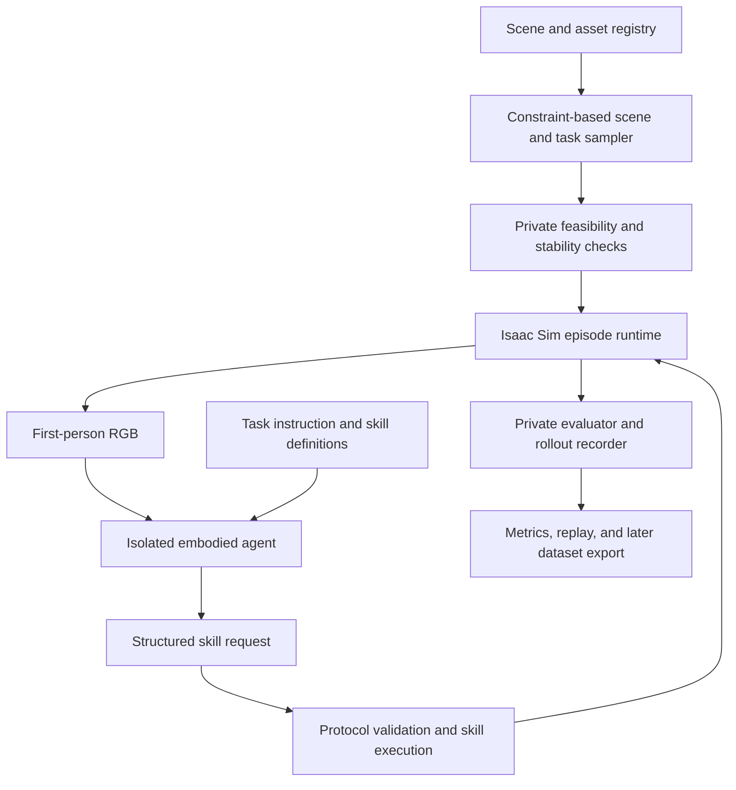

# Embodied Mosaic

**Scalable World and Task Generation for Embodied Agents**

Embodied Mosaic is a research project for building diverse, physically grounded indoor environments and running robot tasks in them. It brings together reusable scenes, objects, robots, and skills through a programmable pipeline built around **Isaac Sim 5.1**.

The first milestone is a complete loop: generate a valid task, let a robot act from first-person images, and independently evaluate the outcome. Once that loop is reliable, the project will scale across randomized environments and extend to manipulation, multiple robots, and dense spatial supervision.

> **Status: early development.** The initial agent protocol prototype and six protocol boundary tests have been implemented in the development workspace. Simulator integration, restricted model transport, and end-to-end task execution remain in progress. This README describes the intended system; a runnable package has not yet been released here.

## What we are building

- **Constraint-based scene generation:** sample assets, placements, orientations, and task configurations while checking support, clearance, connectivity, and physical stability.
- **Episode-scoped embodied agents:** give each agent a task, its own first-person view, and a bounded skill interface, with no access to scene ground truth or other episodes.
- **Reusable robot skills:** translate validated structured actions into physical robot control.
- **Independent evaluation:** separate invalid environments, runtime failures, and unsuccessful agent behavior.
- **Reproducible batch execution:** preserve seeds, asset versions, initial states, action logs, and failure records.
- **Spatial training data:** later export multi-view RGB-D, persistent point tracks, and dense rigid-body trajectory reconstruction.

## Architecture



The generator and evaluator can use simulator state to construct and verify tasks. The acting agent receives only its explicit observation payload. Private state, feasibility routes, and evaluation diagnostics are kept outside that payload.

## Initial scope

| Component | First milestone |
|---|---|
| Environment | One indoor scene per episode |
| Robot | One mobile robot |
| Task | Visual navigation to a specified target |
| Observation | Robot-mounted first-person RGB, 640 × 480 |
| Recording | 30 fps; agent decisions occur at skill boundaries |
| Agent | `gpt-6.1-sol` as the initial configured model |
| Actions | Move forward, turn, wait, declare completion |
| Termination | Completion, failure, or configured action/time budget |
| Cameras | Fixed ego camera; external camera planning comes later |

Episodes retain their full duration. Short training clips can be extracted afterward without truncating the task log.

## Agent interface and isolation

Each episode starts a new agent session. The session ends when that task finishes or exhausts its budget, and its context is not reused for another task.

**Allowed inputs**

- A semantic task instruction.
- The current first-person RGB image.
- Available skills and their parameter definitions.
- A bounded history of the agent's own actions within the episode.

**Excluded inputs and capabilities**

- Other conversations, episodes, or their logs.
- Scene maps, object inventories, world poses, depth, segmentation, or navigation meshes.
- Ground-truth success labels and private evaluator diagnostics.
- Host filesystem, shell, network tools, or arbitrary code execution.

The agent returns a structured skill request:

```json
{
  "episode": "opaque_episode_id",
  "observation_id": 4,
  "skill": "turn",
  "arguments": {
    "angle_deg": 30
  }
}
```

The executor validates the episode identifier, observation index, skill name, and parameter bounds before applying an action. After execution, the agent receives a new image. Declaring completion is a request for independent evaluation, not proof of success.

Context isolation and runtime permissions are separate requirements. A fresh conversation alone does not restrict tools or file access. The production model transport must enforce the restricted interface before the first simulator pilot is accepted.

## Scene and task generation

1. **Register assets:** record provenance, licenses, revisions, dependencies, units, and physical properties.
2. **Validate assets:** check materials, collision geometry, articulation, and robot controllers.
3. **Sample configurations:** vary buildings, objects, orientations, spawn locations, lighting, and goals.
4. **Apply constraints:** preserve support relations, navigable space, robot clearance, and task reachability.
5. **Settle and inspect:** run physics warm-up and reject unstable or penetrating configurations.
6. **Freeze the episode:** save the seed, configuration, initial state, and private success criteria.
7. **Execute and evaluate:** run the visual agent loop and preserve both successful and failed attempts.

Collision checks cover sampled configurations and planned motion where available. Online execution still requires contact monitoring and safety stops, especially when the agent chooses actions that were not planned in advance.

## Reusing open-source components

The project will build on existing simulation and asset infrastructure, with a thin project-specific layer for generation, agent isolation, and evaluation.

| Component | Intended reuse | Integration status |
|---|---|---|
| [Isaac Lab](https://github.com/isaac-sim/IsaacLab) | Robot control, sensors, and simulation interfaces | Target the existing Isaac Sim 5.1-compatible environment |
| [IsaacLab-Arena](https://github.com/isaac-sim/IsaacLab-Arena) | Asset registry, scene–robot–task composition, policy evaluation | Candidate; compatibility pilot required |
| [MolmoSpaces](https://github.com/allenai/molmospaces) | Indoor assets, asset management, and task-generation design | Selective reuse |
| [MolmoSpaces-Isaac](https://github.com/allenai/molmospaces/tree/main/molmo_spaces_isaac) | USD conversion and scene/asset loading | Candidate for asset integration |
| [InternUtopia](https://github.com/InternRobotics/InternUtopia) | GRScenes tooling, robot interfaces, and navigation/task examples | Selective adaptation |

Asset support and full runtime support are different. MolmoSpaces documents Isaac-compatible assets, while its main data-generation and benchmarking pipeline targets MuJoCo. InternUtopia's documented Isaac Sim 4.5 interfaces require adaptation for our 5.1 target. Dependencies will be pinned after compatibility testing rather than tracking upstream default branches.

## Evaluation

The pipeline will report three distinct outcomes:

| Layer | Questions |
|---|---|
| Generation | Was the scene valid, stable, and the task feasible? How many attempts were needed? |
| Runtime | Did physics, rendering, action execution, and recording complete correctly? |
| Agent | Did the robot accomplish the task within its budget? |

Additional measurements include scene and asset diversity, task success on unseen environments, GPU time per accepted episode, model decision latency, recovery frequency, and total cost including rejected attempts.

Dataset splits will separate buildings and asset families. Random rearrangements of the same building will not be treated as independent train/test environments.

## Roadmap

- [ ] **Compatibility pilot:** select a pinned framework stack and test Arena against the existing Isaac Sim 5.1 runtime.
- [ ] **Single-task loop:** connect restricted model transport, ego RGB, physical skills, and private evaluation.
- [ ] **Randomization pilot:** run a proposed 64-episode study across scene, asset, layout, and task variations.
- [ ] **Stable batch generation:** expand toward 512 episodes after pilot acceptance, with explicit diversity quotas and bounded retries.
- [ ] **Interaction and embodiments:** add humanoids, manipulators, graspable objects, and articulated objects such as drawers.
- [ ] **Multiple agents:** extend execution while preserving each agent's observation and context boundaries.
- [ ] **Multi-view spatial data:** add external camera planning, replay rendering, and H5 export.

The protocol prototype is an early development artifact. Model transport isolation and simulator integration are not yet validated end to end.

## Planned spatial data export

A later data stage will share RGB-D and calibration across two representations:

- **Persistent point flow:** 8,000 sampled points with per-frame coordinates, using a 2 mm quantization step where applicable.
- **Dense rigid-body reconstruction:** per-pixel body assignments and complete body SE(3) trajectories, allowing valid RGB-D source pixels to be back-projected and transported to other frames.

Dense reconstruction is not limited to the 8,000 sampled points. It covers observed source surfaces under the rigid-body representation; deformable surfaces require an explicit additional representation. Visibility and occlusion at the target frame are evaluated separately from the existence of a 3D trajectory.

## Running the project

A public installation and launch workflow will be added after the compatibility pilot. The target deployment uses GPU simulation workers, shared asset storage, and an external model service. Simulation and model inference communicate through explicit observation/action messages.

Until those integrations are validated, the roadmap should not be interpreted as a working command-line release.

## Licensing and attribution

The project code license is to be selected before code release. Third-party code, robot models, textures, scenes, and objects retain their respective licenses. Asset provenance and usage terms will be tracked independently of the project code.
